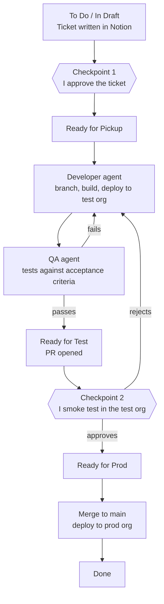

# sf-agent-lab

A hands-on lab for running a Salesforce DevOps pipeline with AI agents.
Claude Code agents pick up tickets from a Notion board, build the change as Salesforce metadata,
deploy it to a test org, test it, and promote it to production. Nothing gets built or deployed to prod
without my sign-off at two human checkpoints.

**Live ticket board (read-only):** [sf-agent-lab on Notion](https://special-zone-ff2.notion.site/sf-agent-lab-4173f0939ee8817aacc7fb51741f29a1)

---

## How it works



### Ticket stages

| Status | What happens | Who moves the card here |
|---|---|---|
| To Do / In Draft | Ticket is written: user story, acceptance criteria, steps to reproduce (for bugs) | Me, or an agent drafting a ticket |
| Ready for Pickup | **Checkpoint 1:** I've reviewed and approved the ticket | **Me only** |
| In Progress (Build & Test) | Developer agent builds on a branch and deploys to test; QA agent tests; they loop until QA passes (max 3 attempts, then I'm flagged) | Developer agent |
| Ready for Test | QA passed and a pull request is open; waiting on my smoke test | Developer agent |
| Ready for Prod | **Checkpoint 2:** I smoke-tested and approved for production | **Me only** |
| Done | PR merged to `main`, `main` deployed to prod | Agent, after a successful deploy |

---

## The pieces

| Piece | Role |
|---|---|
| **Notion** | Ticket board: the source of truth for what to build and where each ticket stands |
| **Claude Code** | Runs the agents on my machine, inside this project folder |
| **Salesforce CLI (`sf`)** | How the agents work in Salesforce: deploy, retrieve, run tests, query data |
| **Git + GitHub** | Version history for the metadata and the agent setup; one branch per ticket, `main` = prod |
| **Two Salesforce orgs** | `test` (all building and testing) and `prod` (only approved changes), both free Developer Edition orgs |

### The agents

- **Developer agent** ([`.claude/agents/developer.md`](.claude/agents/developer.md)) builds the ticket as metadata on a `SFLAB-<id>` branch, deploys to the test org, fixes what QA finds, and opens the pull request.
- **QA agent** ([`.claude/agents/qa.md`](.claude/agents/qa.md)) is kept separate so the code isn't grading itself. It tests the change in the test org against each acceptance criterion and records Pass/Fail on the ticket. It doesn't edit or deploy anything.
- **`/run-ticket`** ([`.claude/commands/run-ticket.md`](.claude/commands/run-ticket.md)) is the one command I run. It reads the card's status and does the next step.

---

## Guardrails

The human checkpoints are enforced two ways:

1. **Rules** ([`CLAUDE.md`](CLAUDE.md)): agents may never move a card into Ready for Pickup or Ready for Prod, never start a ticket that isn't approved, and never deploy to prod unless the card is in Ready for Prod.
2. **Permissions** ([`.claude/settings.json`](.claude/settings.json)): test-org commands and branch pushes run freely, any prod deploy or merge to `main` always stops for my approval, and deleting orgs or force-pushing is blocked.

---

## Repo layout

```
sf-agent-lab/
├── CLAUDE.md                    shared rules every agent follows
├── .claude/
│   ├── agents/
│   │   ├── developer.md         developer agent
│   │   └── qa.md                QA agent
│   ├── commands/
│   │   └── run-ticket.md        /run-ticket command
│   └── settings.json            what agents may do without asking
├── force-app/main/default/      Salesforce metadata (fields, flows, Apex, permission sets)
└── sfdx-project.json            Salesforce DX project config
```

---

## Running it

```bash
# one-time: log the Salesforce CLI into both orgs
sf org login web --alias test
sf org login web --alias prod
sf config set target-org test

# then, in Claude Code opened in this folder
/run-ticket SFLAB-<id>
```

---

## Progress log

- **Setup:** two Developer Edition orgs, Salesforce CLI, git, and GitHub connected; Salesforce DX project created.
- **First manual round trip:** built a `Renewal_Date__c` field on Opportunity in test, retrieved it into the repo,
  committed it, and deployed it to prod with the CLI, the same loop the agents automate.
- **Ticket board:** Notion kanban with six stages and fields for user story, acceptance criteria,
  steps to reproduce, QA results, git branch, and PR.
- **Agents:** shared rules, developer and QA agents, `/run-ticket`, and permission guardrails.
- **Next:** run the first ticket end to end through the agents.
